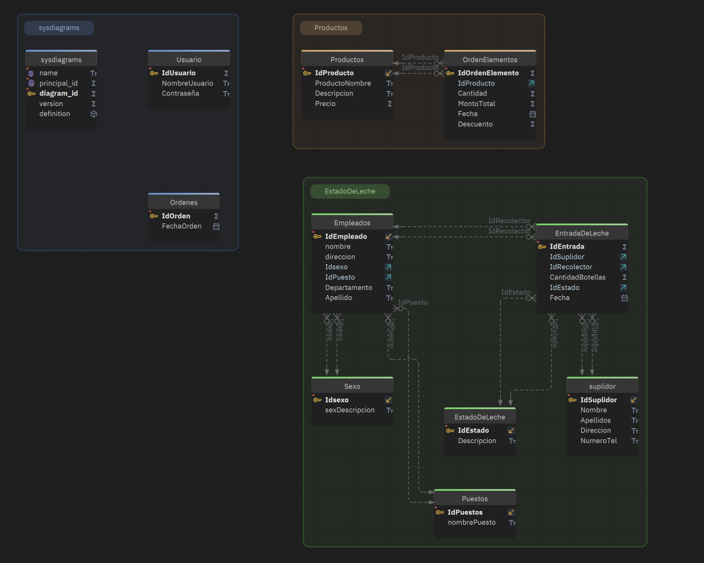

# 🧀 ChessDbQueryCreate

> Práctica académica de SQL Server para la gestión de datos de una quesería.

Este proyecto modela parte de la operación administrativa de una quesería, con énfasis en el registro de suplidores y de la leche recibida. El script también incluye datos de empleados, catálogos, productos, pedidos y usuarios.

## 📦 Contenido de la base de datos

El archivo [`ChessDB.sql`](ChessDB.sql) crea la base `ChessDB` y contiene estas tablas:

| Área | Tablas |
| --- | --- |
| Personal y catálogos | `Empleados`, `Puestos`, `Sexo`, `EstadoDeLeche` |
| Recepción de leche | `suplidor`, `EntradaDeLeche` |
| Productos y pedidos | `Productos`, `Ordenes`, `OrdenElementos` |
| Usuarios | `Usuario` |

También incluye procedimientos almacenados para registrar, consultar, actualizar y eliminar empleados, suplidores, entradas de leche y productos.

## 🧩 Diagrama entidad-relación

El diagrama muestra las tablas y llaves foráneas que existen actualmente en el script. `Ordenes` no tiene una relación definida con `OrdenElementos` en el esquema actual. `sysdiagrams` es una tabla de soporte de SSMS para almacenar diagramas; no forma parte de las operaciones de la quesería.

*Diagrama entidad-relación de la base de datos de la quesería.*

## 🛠️ Requisitos

- Microsoft SQL Server.
- SQL Server Management Studio (SSMS), u otra herramienta compatible con scripts T-SQL y el separador `GO`.
- Permisos para crear una base de datos en la instancia local.

## ▶️ Crear la base de datos en tu PC

1. Inicia tu instancia local de SQL Server y conéctate desde SSMS.
2. Abre `ChessDB.sql`.
3. El script usa las ubicaciones predeterminadas de archivos de SQL Server para crear la base de datos.
4. Confirma que no exista ya una base llamada `ChessDB`: el script usa `CREATE DATABASE` y no está preparado para ejecutarse varias veces.
5. Ejecuta el script con **F5**.
6. Cuando termine, abre **Database Diagrams** en SSMS para revisar el modelo. La captura incluida en `docs/` corresponde al diagrama actual.

El script comienza en `master`, crea `ChessDB`, define las tablas, llaves foráneas y procedimientos almacenados, y al final vuelve a `master`.

## 🔐 Alcance de la práctica

El repositorio contiene el script de base de datos, pero no una aplicación ni registros de ejemplo. La tabla `Usuario` guarda `Contraseña` como texto y el procedimiento `SP_SelectLoginUser` compara ese valor directamente. Usa solo datos ficticios; una aplicación real debe almacenar contraseñas con un algoritmo de hash y aplicar controles de acceso adecuados.

---

Práctica académica de gestión de una quesería · Diagrama entidad-relación incluido
